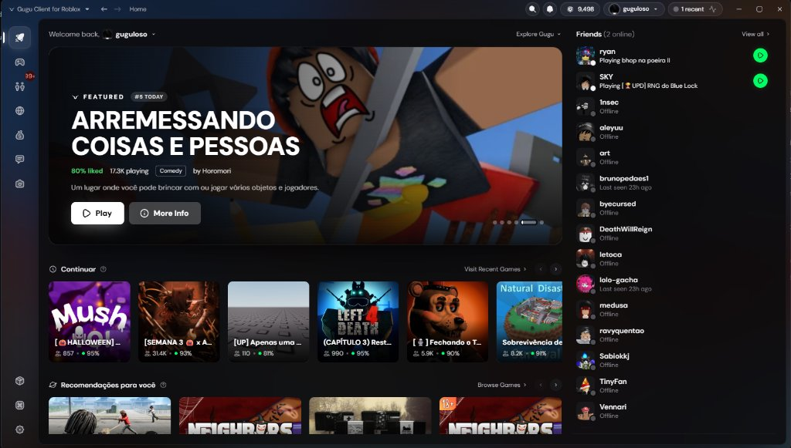

<h1 align="center">
    Gugu Client
</h1>

<p align="center">
    A fast, native Roblox launcher &amp; client — FastFlag tuning, mods, multi-account, social and a 3D avatar studio in one small executable.
</p>

<p align="center">
    
</p>

<p align="center">
    If you'd like to support this project, consider giving this repository a star!
</p>

<div align="center">

[![License][badge-repo-license]][repo-license]
[![CI][badge-repo-ci]][repo-actions]
[![Downloads (Total)][badge-repo-downloads-total]][repo-releases]
[![Downloads (Latest)][badge-repo-downloads]][repo-releases]
[![Version][badge-repo-latest]][repo-latest]
[![Stars][badge-repo-stars]][repo-stargazer]

</div>

> [!CAUTION]
> The official repository [guguloso/guguclient](https://github.com/guguloso/guguclient) is the **ONLY PLACE** where you should download the official Gugu Client executable. Any other source is **NOT** affiliated with us and may pose a potential security threat.

<p align="center">
    
</p>

---

## Features

### Play
- **Instances**: separate Roblox setups, each with its own FastFlags, mods, fonts and account
- **Multi-Instance**: run several Roblox sessions at once and track them from the title bar or system tray
- **FastFlag Profiles &amp; Editor**: unlock FPS caps, tune lighting, rendering and textures before Roblox starts
- **Mods**: custom cursors, sounds, fonts and game assets per instance
- **Deep links**: `roblox://` support — click Play on the Roblox website and launch through Gugu Client
- **Macros**: record, bind and share macros per game

### Social
- **Friends &amp; presence**: see who is online and join their game in one click
- **Chat, trades and communities** without opening the browser
- **Account Switcher**: sign in once per account and switch instantly

### Avatar
- **3D avatar preview** with animations (idle, walk, run, emotes), layered clothing and dynamic heads
- Saved characters, outfits and the catalog side by side

### Integrations
- **Discord Rich Presence** with the experience, creator, playtime and **Join Server** buttons
- Full **Bloxstrap RPC** support for in-game status updates
- **Automatic updates** for both Roblox versions and Gugu Client itself, straight from GitHub releases

---

## Built with Rust

Gugu Client is a fork of **Lunar for Roblox**, rebuilt with a native **Rust + [Tauri 2](https://tauri.app)** backend and actively maintained with constant updates — no Electron, no bundled Chromium, no Node.js runtime.

- **Fast native setup**: one ~12 MB `GuguClient-Setup-windows-x64.exe` installer written in pure Rust that sets up `GuguClient.exe` (~23 MB) with WebView2 rendering
- **Multi-language UI**: automatically adapts to your Windows language/region (**Português (Brasil)**, **English**, **Español**), with manual switching in **Settings → Appearance**
- **Native backend**: accounts, instances, FastFlags, mods, Discord RPC, macros, captures and the avatar renderer all run in async Rust on Tokio
- **Light on resources**: around 50 MB of RAM for the launcher process

```
guguclient/
├── src-tauri/          # Rust backend (Tauri 2)
│   ├── src/
│   │   ├── ipc/        # IPC router: one command serves every `window.api` channel
│   │   ├── roblox/     # Roblox web API client (CSRF, challenges, rate limits)
│   │   └── services/   # Launch, versions, mods, macros, social, avatar render…
│   ├── scripts/        # prepare-frontend.mjs: embeds the UI and generates the bridge
│   └── icons/
├── setup/              # Native Rust Windows installer (GuguSetup.exe)
├── ui/                 # Launcher UI (renderer + preload API surface + i18n)
├── docs/               # IPC coverage report and devlogs
└── .github/            # CI & Release workflows
```

---

## Quick Start

1. Download **`GuguClient-Setup-windows-x64.exe`** from the latest release on the [Releases][repo-releases] page.
2. Run it — setup completes in seconds with zero extra dependencies.
3. Sign in, set up an instance and launch any Roblox game.

### Where your data lives

| What | Location |
| --- | --- |
| Accounts, settings, instances, Roblox versions | `%USERPROFILE%\.gugu-for-roblox\` |
| Logs | `%USERPROFILE%\.gugu-for-roblox\logs\` |
| Screenshots and clips | `%USERPROFILE%\Videos\Gugu\` |

Coming from an older build? Your existing `.lunar-for-roblox` folder and `Videos\Lunar` captures are moved to the new locations on first launch.

### System Requirements
- **OS:** Windows 10 or Windows 11 (64-bit)
- **Runtime:** Microsoft Edge WebView2 (preinstalled on Windows 11 and up-to-date Windows 10)

---

## Building from Source

Requires [Rust](https://rustup.rs) (MSVC toolchain) and Node.js 20+.

```powershell
cd src-tauri
node scripts/prepare-frontend.mjs
cargo build --release --features custom-protocol
```

The executable is written to `src-tauri/target/release/GuguClient.exe`. See [BUILDING.md](./BUILDING.md) for development, tests and releases.

---

## Licensing

Custom additions and build tooling in this repository are licensed under the [MIT License](./LICENSE).

## Stargazing

To support the development of Gugu Client, consider giving the repository a star.

<a href="https://www.star-history.com/?repos=guguloso%2Fguguclient&type=date&legend=top-left">
 <picture>
   <source media="(prefers-color-scheme: dark)" srcset="https://api.star-history.com/chart?repos=guguloso/guguclient&type=date&theme=dark&legend=top-left" />
   <source media="(prefers-color-scheme: light)" srcset="https://api.star-history.com/chart?repos=guguloso/guguclient&type=date&legend=top-left" />
   
 </picture>
</a>

<!-- Badge defs -->
[badge-repo-license]: https://img.shields.io/github/license/guguloso/guguclient?style=for-the-badge&color=18181b&labelColor=27272a
[badge-repo-ci]: https://img.shields.io/github/actions/workflow/status/guguloso/guguclient/ci.yml?branch=main&style=for-the-badge&color=18181b&labelColor=27272a
[badge-repo-downloads]: https://img.shields.io/github/downloads/guguloso/guguclient/latest/total?style=for-the-badge&color=18181b&labelColor=27272a
[badge-repo-downloads-total]: https://img.shields.io/github/downloads/guguloso/guguclient/total?style=for-the-badge&color=18181b&labelColor=27272a
[badge-repo-latest]: https://img.shields.io/github/v/release/guguloso/guguclient?style=for-the-badge&color=ffffff&labelColor=18181b
[badge-repo-stars]: https://img.shields.io/github/stars/guguloso/guguclient?style=for-the-badge&color=18181b&labelColor=27272a

[repo-license]: https://github.com/guguloso/guguclient/blob/main/LICENSE
[repo-actions]: https://github.com/guguloso/guguclient/actions
[repo-releases]: https://github.com/guguloso/guguclient/releases
[repo-latest]: https://github.com/guguloso/guguclient/releases/latest
[repo-stargazer]: https://github.com/guguloso/guguclient/stargazers
